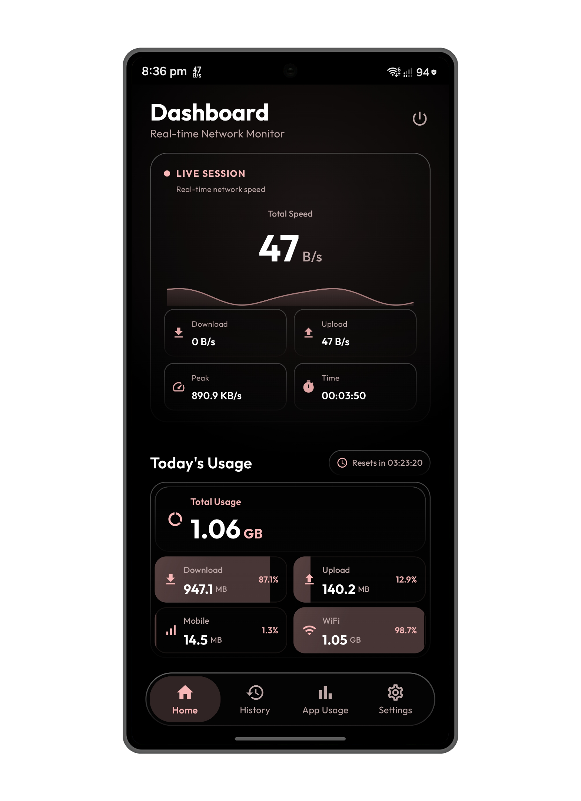
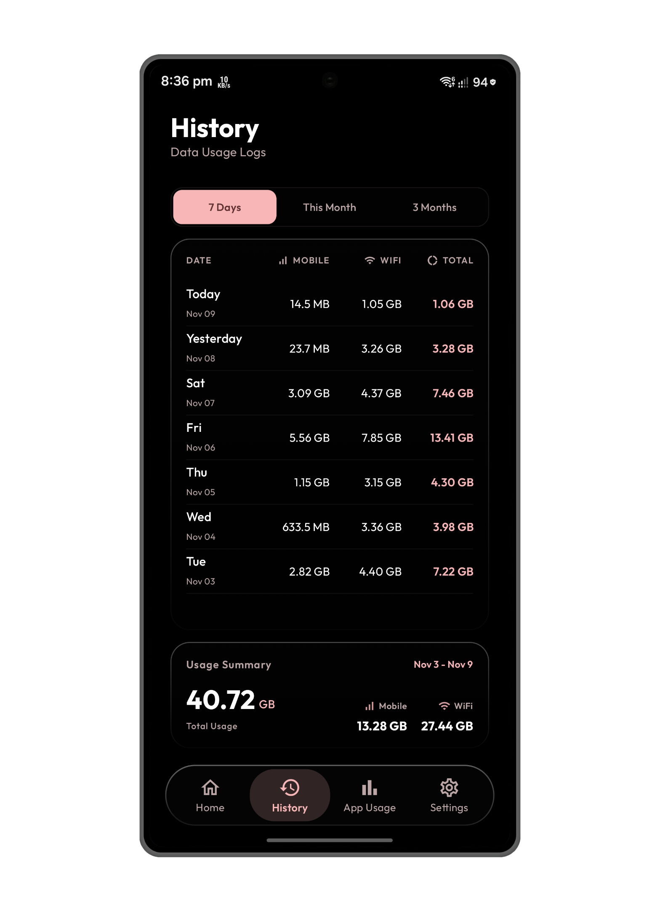
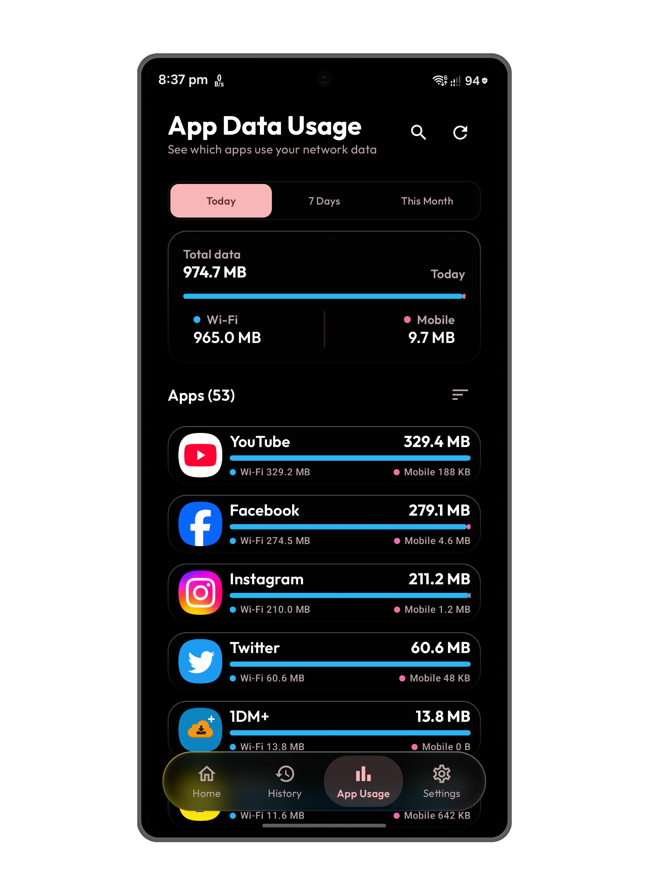
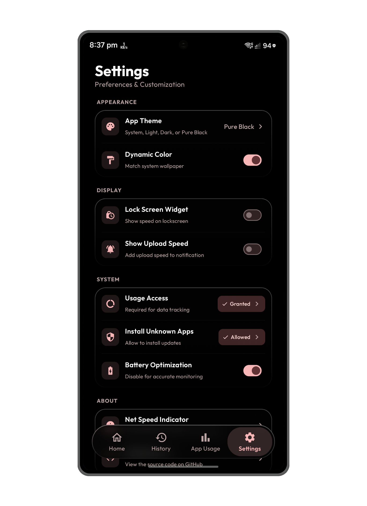

<p align="center">
  
</p>

<p align="center">
  A modern Android network speed monitor that keeps real-time traffic speed and data usage visible at a glance.
</p>

<p align="center">
  
  
  
  <br>
  
  
  <a href="https://github.com/Darkstar085/SpeedIndicator/actions/workflows/release.yml"></a>
  
</p>

---

## ✨ Features

- ⚡ Real-time download and upload speed monitoring
- 📊 Live speed waveform with peak speed and session duration
- 📶 Separate Wi-Fi and mobile data usage tracking
- 📱 Per-app network data usage with Wi-Fi and mobile breakdowns
- 📅 Daily, monthly, and historical usage logs
- 🎨 System, light, and dark themes with dynamic color support
- 🔔 Persistent live speed notification with promoted ongoing placement request
- 🔄 Automatic service recovery after process recreation and periodic six-hour recovery checks
- ♻️ Automatic retry when the live speed stream encounters an error
- 🔒 Usage Access and Battery Optimization controls
- ⬇️ In-app update download and installation
- 🚀 Foreground service with automatic startup after reboot
- 📱 Modern Jetpack Compose and Material 3 UI

## 🖼️ Screenshots

<p align="center">
  
  
</p>
<p align="center">
  
  
</p>

## 🧰 Tech Stack

| Area                    | Technology                                                                                         |
|-------------------------|----------------------------------------------------------------------------------------------------|
| Language                | Kotlin 2.4.10, Java 17                                                                             |
| Android                 | Min API 28, compile / target API 37                                                                |
| Build                   | Gradle 9.7.1, Android Gradle Plugin 9.3.0, KSP 2.3.10                                              |
| UI                      | Jetpack Compose (BOM 2026.06.01), Material 3, Navigation Compose 2.9.8                             |
| Dependency injection    | Hilt 2.60.1                                                                                        |
| Local storage           | Room 2.8.4, Preferences DataStore 1.2.1                                                            |
| Async & background work | Kotlin Coroutines / Flow, WorkManager 2.11.2, Android JobScheduler                                 |
| Serialization           | Kotlinx Serialization 1.11.0                                                                       |
| UI libraries            | Lottie Compose 6.7.1, Vitro 0.1.0                                                                  |
| Testing                 | JUnit 4.13.2, Robolectric 4.14.1, Coroutines Test 1.10.2, AndroidX Test Core 1.6.1, Espresso 3.7.0 |

## 🗂️ Project Structure

The project is a single Android application module (`:app`), with the source organized into core,
data, domain, and UI packages.

```text
.
├── .github/
│   ├── assets/                         # README banner and screenshots
│   ├── badges/                         # Generated APK download badge data
│   ├── scripts/                        # Build, release, badge, and cleanup scripts
│   └── workflows/                      # Debug, release, badge, and cleanup workflows
├── app/
│   ├── build.gradle.kts
│   └── src/
│       ├── main/
│       │   ├── AndroidManifest.xml
│       │   ├── res/                    # App resources
│       │   └── kotlin/com/sipun/netspeedindicator/
│       │       ├── MainActivity.kt
│       │       ├── NetSpeedApplication.kt
│       │       ├── core/
│       │       │   ├── di/
│       │       │   ├── network/
│       │       │   ├── receiver/
│       │       │   ├── service/
│       │       │   ├── state/
│       │       │   ├── update/
│       │       │   └── util/
│       │       ├── data/
│       │       │   ├── datasource/
│       │       │   ├── local/
│       │       │   │   ├── dao/
│       │       │   │   └── entity/
│       │       │   ├── mapper/
│       │       │   ├── preferences/
│       │       │   └── repository/
│       │       ├── domain/
│       │       │   ├── model/
│       │       │   ├── repository/
│       │       │   └── usecase/
│       │       └── ui/
│       │           ├── components/
│       │           ├── navigation/
│       │           ├── screens/
│       │           │   ├── main/
│       │           │   │   ├── appusage/
│       │           │   │   ├── history/
│       │           │   │   ├── home/
│       │           │   │   └── settings/
│       │           │   └── onboarding/
│       │           ├── theme/
│       │           └── util/
│       └── test/
│           └── kotlin/com/sipun/netspeedindicator/
│               ├── core/
│               ├── data/
│               ├── domain/
│               ├── ui/
│               └── MainDispatcherRule.kt
├── gradle/
│   ├── libs.versions.toml              # Central dependency versions
│   └── wrapper/                        # Gradle wrapper configuration
├── build.gradle.kts
├── settings.gradle.kts
├── gradle.properties
├── gradlew
├── gradlew.bat
└── README.md
```

### Architecture Overview

- **`core`** — app-wide dependency injection, connectivity monitoring, foreground services, shared
  traffic state, update handling, permissions, and notification utilities.
- **`data`** — traffic and app-usage data sources, Room persistence, preferences, data mapping, and
  repository implementations.
- **`domain`** — usage and speed models, repository contracts, and application use cases.
- **`ui`** — Jetpack Compose screens, ViewModels, navigation, reusable components, and theming.

## 🚀 Quick Start

### Requirements

- Android Studio
- JDK 17
- Android SDK 37 for development
- Android 9.0 (API 28) or newer for the app

### Clone

```bash
git clone https://github.com/Darkstar085/SpeedIndicator.git
cd SpeedIndicator
```

### Build

```bash
./gradlew assembleDebug
```

The generated debug APK is available under `app/build/outputs/apk/debug/`.

## 📦 Releases

Download the latest APK from
the [latest release](https://github.com/Darkstar085/SpeedIndicator/releases/latest), or browse all
available builds on the [Releases](https://github.com/Darkstar085/SpeedIndicator/releases) page.

## 🔐 Permissions

Speed Indicator uses Android's network and usage statistics APIs to measure traffic and present
usage information. Some features require additional system access, which can be enabled from
**Settings** inside the app.

- **Usage Access** — required for data usage tracking.
- **Battery Optimization** — can be disabled to improve continuous monitoring reliability.
- **Install Unknown Apps** — required when installing updates downloaded directly by the app.

## 💡 Inspiration

The project was inspired by the open-source
**[NetSpeedIndicator](https://github.com/ronyaburaihan/NetSpeedIndicator)**. It influenced the
initial concept of building an Android network speed and data usage monitor.

## 🤝 Contributing

Bug reports, suggestions, and improvements are welcome. Please keep contributions focused and follow
the existing Kotlin and Jetpack Compose conventions.

## 📄 License

Speed Indicator is licensed under the [MIT License](LICENSE).

---

<p align="center">
  <strong>Speed Indicator</strong> — Know your network at a glance.
</p>
